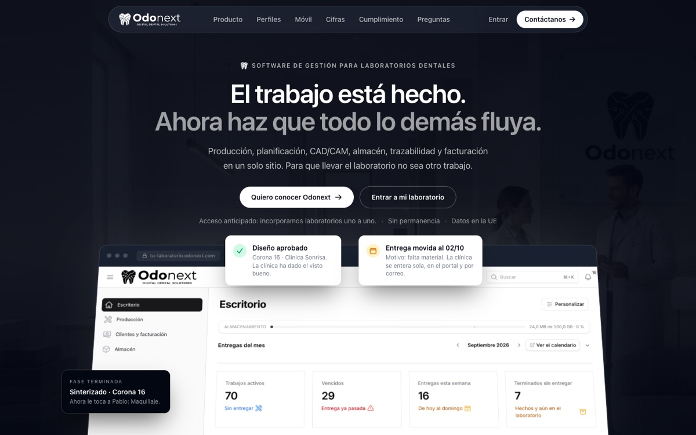
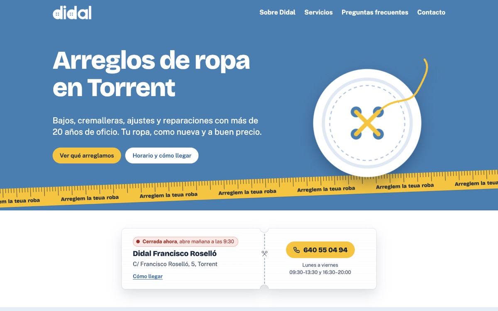
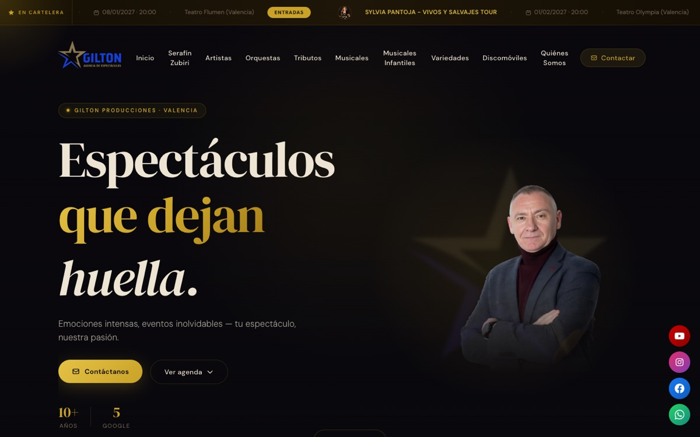

 

Soy **Ricardo Andreu**. Diseño y programo webs y software para negocios, del diseño al servidor, y durante el proyecto **hablas siempre conmigo**: no con un comercial ni con un sistema de tickets.

Empecé en sistemas y llegué a la programación de la mano de un amigo que acabó siendo mi mentor. Esa mezcla de sistemas, código y diseño es la que me permite encargarme de un proyecto entero.

### Ahora mismo

- Doy soporte a los sistemas de emisión de una televisión, donde un fallo se ve en directo.
- Mantengo **[Odonext](https://odonext.com)**, el software de gestión con el que trabaja cada día un laboratorio dental.
- Automatizo la captación de clientes de mi propio negocio con n8n.
- Estudio Desarrollo de Aplicaciones Multiplataforma.

### Con qué trabajo

### Proyectos

**[Odonext](https://odonext.com)**: mi propio producto. Software de gestión para laboratorios dentales, que reúne producción, planificación, almacén, trazabilidad y facturación en un solo sitio. Lo he diseñado, lo he programado y lo mantengo yo.

<table>
  <tr>
    <td width="50%" valign="top">
      
      
<b><a href="https://didalcomposturas.com">Didal Composturas</a></b> Web para un taller de arreglos de ropa en Torrent. Muestra si la tienda está abierta en ese momento, y sus animaciones salen del propio oficio: botones que se cosen, una cinta métrica y un perchero.

    </td>
    <td width="50%" valign="top">
      
      
<b><a href="https://espectaculosgilton.com">Gilton Producciones</a></b> Web y panel de gestión para una agencia de espectáculos de Valencia, con agenda de eventos y catálogo de artistas, orquestas y musicales.

    </td>
  </tr>
</table>

### Cómo trabajo

1. **Hablamos.** Una llamada o un café para entender qué necesitas, sin tecnicismos.
2. **Propuesta cerrada.** Qué voy a hacer, cuánto cuesta y cuándo estará. Sin sorpresas.
3. **Diseño y desarrollo.** Ves avances cada semana y opinas antes de que nada quede cerrado.
4. **Entrega y después.** Publicamos, te enseño a usarlo y sigo ahí si necesitas algo.

### Hablemos

**[ricardoandreu.com](https://ricardoandreu.com)** · [hola@ricardoandreu.com](mailto:hola@ricardoandreu.com) · [Instagram](https://www.instagram.com/ricardoandreu.dev/) · [LinkedIn](https://www.linkedin.com/in/ricardo-andreu-623219269/)

Las ilustraciones de este perfil son SVG animados generados con <a href="herramientas/generar.py">herramientas/generar.py</a>: la fuente va incrustada y recortada a las letras que se usan.
